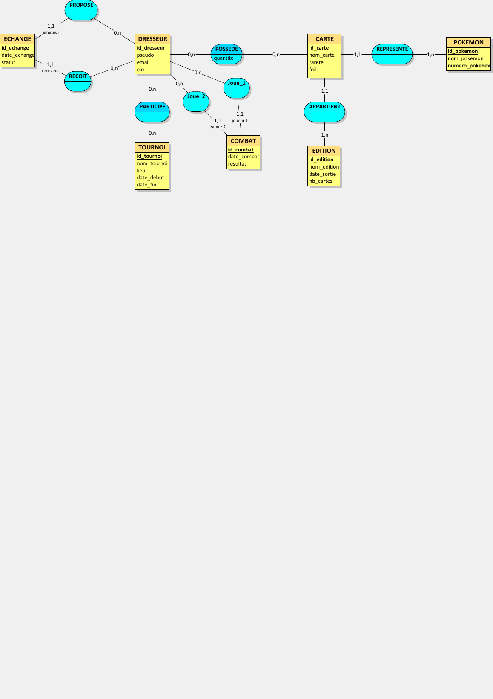
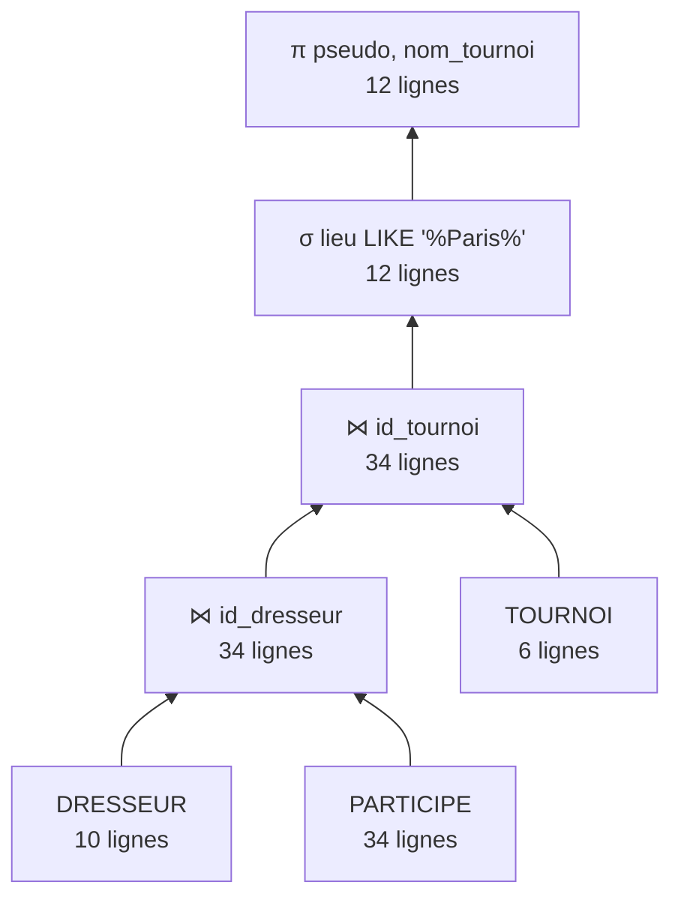
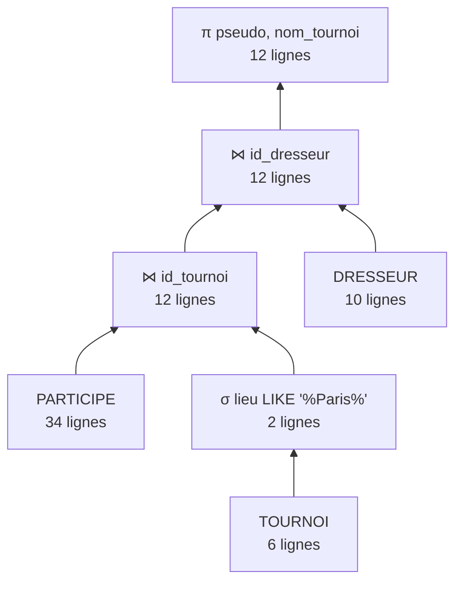

[README_Pokedex_TCG.md](https://github.com/user-attachments/files/33560656/README_Pokedex_TCG.md)
# TI503N – Mini-projet de base de données : PokéDex TCG

## Présentation du domaine

**Organisation : PokéDex TCG**  
Plateforme en ligne de gestion de collections de cartes Pokémon (TCG). Elle permet aux dresseurs de gérer leur collection, d'échanger des cartes, de participer à des tournois et de suivre les éditions disponibles.

---

## Étape 1 : Analyse des besoins

### Prompt utilisé

```
Tu travailles dans le domaine du jeu vidéo et de la gestion de collections de jeux de cartes à collectionner Pokémon. Ton organisation a comme activité de gérer une plateforme en ligne dédiée aux dresseurs Pokémon : elle recense les cartes disponibles, gère les collections des utilisateurs, organise des tournois et facilite les échanges entre joueurs. C'est une organisation comme Pokémon Company, PokeCardex, ou TCGPlayer. Les données portent principalement sur les cartes Pokémon (caractéristiques, éditions, raretés), les dresseurs (comptes utilisateurs, collections), les tournois et matchs organisés, ainsi que les transactions d'échange entre joueurs.

Inspire-toi du site web officiel https://www.pokemon.com/fr/jeu-de-cartes-pokemon, et de la documentation de la base de données publique https://pokemontcg.io ainsi que de la plateforme de référence https://www.tcgplayer.com.

Ton organisation — appelée PokéDex TCG — veut appliquer MERISE pour concevoir un système d'information. Tu es chargé de la partie analyse, c'est-à-dire de collecter les besoins auprès de l'organisation. Elle a fait appel à un étudiant en ingénierie informatique pour réaliser ce projet, tu dois lui fournir les informations nécessaires pour qu'il applique ensuite lui-même les étapes suivantes de conception et développement de la base de données.

D'abord, établis les règles de gestions des données de PokéDex TCG, sous la forme d'une liste à puce. Elle doit correspondre aux informations que fournit quelqu'un qui connaît le fonctionnement de l'organisation, mais pas comment se construit un système d'information.

Ensuite, à partir de ces règles, fournis un dictionnaire de données brutes avec les colonnes suivantes, regroupées dans un tableau : signification de la donnée, type, taille en nombre de caractères ou de chiffres. Il doit y avoir entre 25 et 35 données. Il sert à fournir des informations supplémentaires sur chaque donnée (taille et type) mais sans a priori sur comment les données vont être modélisées ensuite.

Fournis donc les règles de gestion et le dictionnaire de données.
```

---

### Règles de gestion (résultat de l'IAG)

- Un dresseur possède un compte unique identifié par son adresse email.
- Un dresseur peut posséder plusieurs cartes dans sa collection ; une même carte (même référence) peut apparaître plusieurs fois dans une collection (exemplaires multiples).
- Chaque carte appartient à une seule édition (set). Une édition regroupe plusieurs cartes.
- Chaque carte a une rareté unique parmi : Commune, Peu commune, Rare, Rare Holographique, Ultra Rare, Secret Rare.
- Chaque carte est associée à un Pokémon ou à un type de carte (Énergie, Dresseur, Objet).
- Un Pokémon appartient à un ou plusieurs types élémentaires (Feu, Eau, Plante, Électrik, etc.).
- Une carte Pokémon peut évoluer depuis une autre carte Pokémon (relation d'évolution).
- Un dresseur peut participer à plusieurs tournois ; un tournoi accueille plusieurs dresseurs.
- Un tournoi se déroule sur une ou plusieurs journées et dans un lieu précis.
- Lors d'un tournoi, les dresseurs s'affrontent en matchs. Un match oppose exactement deux dresseurs.
- Un match a un résultat : victoire d'un des deux joueurs, ou nul (dans le cas de certains formats).
- Un dresseur peut envoyer une proposition d'échange à un autre dresseur, en proposant une ou plusieurs cartes de sa collection contre une ou plusieurs cartes de l'autre.
- Un échange ne peut être finalisé que si les deux dresseurs l'acceptent.
- Une carte échangée doit appartenir à la collection du dresseur qui la propose au moment de l'échange.
- Un dresseur peut noter et commenter une carte (une note par dresseur et par carte).
- Chaque édition de cartes a une date de sortie officielle et un nombre total de cartes dans le set.
- Certaines cartes sont marquées comme "foil" (holographique) ou en version normale, ce qui les distingue même si elles représentent le même Pokémon.
- Un dresseur a un classement ELO qui évolue selon ses résultats en tournoi.

---

### Dictionnaire de données (résultat de l'IAG)

| Signification de la donnée | Type | Taille |
|---|---|---|
| Identifiant unique du dresseur | Entier | 10 chiffres |
| Pseudo du dresseur | Texte | 50 caractères |
| Adresse email du dresseur | Texte | 100 caractères |
| Mot de passe (hashé) du dresseur | Texte | 255 caractères |
| Date d'inscription du dresseur | Date | - |
| Score ELO du dresseur | Entier | 6 chiffres |
| Identifiant unique de la carte | Texte | 20 caractères |
| Nom de la carte | Texte | 100 caractères |
| Numéro de la carte dans l'édition | Entier | 4 chiffres |
| Rareté de la carte | Texte | 30 caractères |
| Points de vie (PV) de la carte Pokémon | Entier | 4 chiffres |
| Indique si la carte est holographique (foil) | Booléen | 1 bit |
| Type élémentaire du Pokémon | Texte | 20 caractères |
| Identifiant unique de l'édition | Texte | 10 caractères |
| Nom de l'édition | Texte | 100 caractères |
| Date de sortie de l'édition | Date | - |
| Nombre total de cartes dans l'édition | Entier | 4 chiffres |
| Nombre d'exemplaires d'une carte dans la collection | Entier | 4 chiffres |
| Identifiant unique du tournoi | Entier | 10 chiffres |
| Nom du tournoi | Texte | 100 caractères |
| Date de début du tournoi | Date | - |
| Date de fin du tournoi | Date | - |
| Lieu du tournoi | Texte | 150 caractères |
| Identifiant unique du match | Entier | 10 chiffres |
| Date et heure du match | DateHeure | - |
| Identifiant du vainqueur du match | Entier | 10 chiffres |
| Identifiant unique de l'échange | Entier | 10 chiffres |
| Statut de l'échange (en attente / accepté / refusé) | Texte | 20 caractères |
| Date de l'échange | Date | - |
| Note attribuée à une carte par un dresseur | Entier | 1 chiffre (1 à 5) |
| Commentaire d'un dresseur sur une carte | Texte | 500 caractères |
| Nom du Pokémon | Texte | 50 caractères |
| Numéro du Pokédex national | Entier | 4 chiffres |
| Attaque principale de la carte | Texte | 60 caractères |
| Dégâts de l'attaque principale | Entier | 4 chiffres |

---

## Étape 2 : MCD

### Choix de modélisation avancée

Les éléments avancés considérés dans la conception sont les suivants (leur représentation dans le fichier Looping reste à vérifier) :

1. **Association récursive** : Le lien d’évolution entre deux cartes est traduit dans le SQL par `id_carte_precedente`.
2. **Lien CARTE / EDITION** : une carte dépend d’une édition. Dans le SQL actuel, elle conserve toutefois un identifiant propre (`id_carte`) : la notion d’entité faible doit donc être confirmée sur le MCD.
3. **Relations autour des échanges** : `PROPOSE` et `RECOIT` utilisent les identifiants de l’échange, de la carte et du dresseur dans le MLD. Il faut s’assurer que les associations correspondantes sont bien visibles dans le schéma conceptuel.

### MCD (image)



---

### Notes sur la modélisation

- L'entité POKEMON est séparée de l'entité CARTE car plusieurs cartes peuvent représenter le même Pokémon (différentes éditions, formes holographiques, etc.).
- La relation COLLECTION entre DRESSEUR et CARTE inclut un attribut `quantite` pour représenter le nombre d'exemplaires.
- La relation AVIS entre DRESSEUR et CARTE inclut les attributs `note` et `commentaire`.
- La relation PARTICIPE entre DRESSEUR et TOURNOI n'a pas d'attributs supplémentaires.
- Les matchs sont modélisés avec deux rôles explicites : JOUE_EN_TANT_QUE_J1 et JOUE_EN_TANT_QUE_J2 pour différencier les deux participants.

---

## Étape 3 : MLD

Le MLD reprend les relations utilisées pour créer les tables. La correspondance exacte entre toutes les tables SQL et le schéma Looping doit encore être contrôlée.

```
DRESSEUR (id_dresseur, pseudo, email, mot_de_passe, date_inscription, elo)

EDITION (id_edition, nom_edition, date_sortie, nb_cartes)

POKEMON (id_pokemon, nom_pokemon, numero_pokedex, type_elementaire)

CARTE (id_carte, nom_carte, numero_carte, rarete, foil, pv, attaque_principale, degats_attaque,
       #id_edition, #id_pokemon, #id_carte_precedente)
  → id_edition         FK → EDITION(id_edition)
  → id_pokemon         FK → POKEMON(id_pokemon)        [nullable : carte non-Pokémon]
  → id_carte_precedente FK → CARTE(id_carte)           [association récursive : évolution]

COLLECTION (id_dresseur, id_carte, quantite)
  → id_dresseur  FK → DRESSEUR(id_dresseur)
  → id_carte     FK → CARTE(id_carte)

TOURNOI (id_tournoi, nom_tournoi, lieu, date_debut, date_fin)

PARTICIPE (id_dresseur, id_tournoi)
  → id_dresseur  FK → DRESSEUR(id_dresseur)
  → id_tournoi   FK → TOURNOI(id_tournoi)

COMBAT (id_combat, date_combat, resultat, #id_joueur1, #id_joueur2, #id_tournoi)
  → id_joueur1   FK → DRESSEUR(id_dresseur)
  → id_joueur2   FK → DRESSEUR(id_dresseur)
  → id_tournoi   FK → TOURNOI(id_tournoi)

ECHANGE (id_echange, date_echange, statut, #id_emetteur, #id_receveur)
  → id_emetteur  FK → DRESSEUR(id_dresseur)
  → id_receveur  FK → DRESSEUR(id_dresseur)

PROPOSE (id_echange, id_carte, id_dresseur)     [association ternaire : cartes offertes]
  → id_echange   FK → ECHANGE(id_echange)
  → id_carte     FK → CARTE(id_carte)
  → id_dresseur  FK → DRESSEUR(id_dresseur)

RECOIT (id_echange, id_carte, id_dresseur)      [association ternaire : cartes demandées]
  → id_echange   FK → ECHANGE(id_echange)
  → id_carte     FK → CARTE(id_carte)
  → id_dresseur  FK → DRESSEUR(id_dresseur)

AVIS (id_dresseur, id_carte, note, commentaire)
  → id_dresseur  FK → DRESSEUR(id_dresseur)
  → id_carte     FK → CARTE(id_carte)
```

**Principes de transformation :**
- Chaque entité devient une table avec sa clé primaire.
- Les associations 1,1 – 0,n : la FK est placée du côté de la cardinalité 1,1 (ex: CARTE porte id_edition).
- Les associations 0,n – 0,n : création d'une table de jonction (COLLECTION, PARTICIPE, AVIS).
- L'association récursive sur CARTE génère un attribut auto-référentiel (id_carte_precedente).
- Les relations PROPOSE et RECOIT possèdent chacune une clé primaire composée de trois attributs.

---

## Étape 4 : Insertion des données

Les données ont été générées avec une IAG en utilisant le prompt disponible dans `prompt_insertion.txt`.

Le script d'insertion est disponible dans `3_insertion_mysql.sql`. Il contient :
- 12 éditions officielles
- 20 Pokémon avec leurs types élémentaires
- 24 cartes couvrant plusieurs raretés et générations
- 10 dresseurs avec des scores ELO variés
- 51 entrées de collection
- 6 tournois répartis entre 2023 et 2024
- 34 participations à des tournois
- 24 combats avec résultats
- 8 échanges (acceptés, refusés, en attente)
- 16 avis avec notes et commentaires

---

## Étape 5 : Scénario d'utilisation

**Rôle : Claire, responsable compétition chez PokéDex TCG**

Claire prépare le bilan annuel 2023 des tournois et l'analyse de la plateforme. Elle a besoin de :

1. **Classement des joueurs** : identifier les dresseurs les plus compétitifs (ELO élevé, victoires en tournoi)
2. **Analyse des collections** : quelles cartes sont les plus détenues et les mieux notées
3. **Activité d'échange** : suivi des propositions en cours et du taux d'acceptation
4. **Statistiques globales** : participation aux tournois, niveau moyen des joueurs par compétition

Les 26 requêtes SQL du fichier `4_interrogation_mysql.sql` correspondent à ce scénario et couvrent notamment :
- 7 projections/sélections avec tri, DISTINCT, LIKE, IN, BETWEEN
- 6 fonctions d'agrégation avec GROUP BY et HAVING
- 6 jointures (internes, externes, multiples, auto-jointure)
- 6 requêtes imbriquées (IN, NOT IN, EXISTS, NOT EXISTS, ANY, ALL)
- 1 requête complémentaire de bilan des victoires (table dérivée et UNION ALL)

Le fichier SQL est disponible dans `4_interrogation_mysql.sql`.

---

## Étude de deux plans d'exécution en algèbre relationnelle

### Scénario et requête

On souhaite afficher les pseudos des dresseurs et les noms des tournois auxquels ils participent, uniquement pour les tournois situés à Paris.

```sql
SELECT d.pseudo, t.nom_tournoi
FROM DRESSEUR d
JOIN PARTICIPE p ON d.id_dresseur = p.id_dresseur
JOIN TOURNOI t ON p.id_tournoi = t.id_tournoi
WHERE t.lieu LIKE '%Paris%';
```

Cette requête utilise trois types d'opérateurs : **projection** (π), **sélection** (σ) et **jointure** (⋈).

Dans notre jeu de données : **DRESSEUR = 10 lignes**, **PARTICIPE = 34 lignes**, **TOURNOI = 6 lignes**. Parmi les 6 tournois, **2** ont lieu à Paris ; ils correspondent à **12 participations**. La requête renvoie ainsi **12 lignes**.

### Plan 1 : jointures avant la sélection



Calcul théorique du nombre d'instructions :

- Première jointure : 10 × 34 = **340**
- Deuxième jointure : 34 × 6 = **204**
- Sélection : lecture de 34 lignes = **34**
- Projection : lecture de 12 lignes = **12**
- **Total : 590 instructions**

### Plan 2 : sélection avant les jointures



Calcul théorique du nombre d'instructions :

- Sélection des tournois : lecture de 6 lignes = **6**
- Première jointure : 2 × 34 = **68**
- Deuxième jointure : 12 × 10 = **120**
- Projection : lecture de 12 lignes = **12**
- **Total : 206 instructions**

### Comparaison et conclusion

| Opération | Plan 1 | Plan 2 |
|---|---:|---:|
| Première jointure | 340 | 68 |
| Deuxième jointure | 204 | 120 |
| Sélection | 34 | 6 |
| Projection | 12 | 12 |
| **Total** | **590** | **206** |

Le **plan 2 est le plus efficace dans ce modèle théorique** : filtrer les tournois parisiens dès le début réduit les tailles des résultats intermédiaires et donc le coût des jointures. Le plan 2 nécessite **384 instructions de moins** que le plan 1. Les deux plans produisent le même résultat de 12 lignes.

Le calcul suit la méthode de l'**exercice 6 du TD3** : une jointure de deux relations de tailles *n1* et *n2* coûte *n1 × n2* instructions ; une sélection ou une projection d'une relation de *n* lignes coûte *n* instructions. Il s'agit d'une estimation pédagogique simplifiée, sans prise en compte des index ni des optimisations internes de MySQL.

---

## Fichiers du projet

| Fichier | Description |
|---|---|
| `README.md` | Documentation complète du projet |
| `prompt_conception_base.txt` | Prompt utilisé pour l'analyse des besoins (Partie 1) |
| `prompt_insertion.txt` | Prompt utilisé pour la génération des données (Partie 2) |
| `MCD_Pokedex_TCG.lo1` | Fichier source du MCD |
| `1_creation_mysql.sql` | Création des tables avec contraintes d'intégrité |
| `2_contraintes_mysql.sql` | Contraintes de validation additionnelles |
| `3_insertion_mysql.sql` | Insertion des données |
| `4_interrogation_mysql.sql` | Requêtes SQL du scénario d'utilisation |


---
